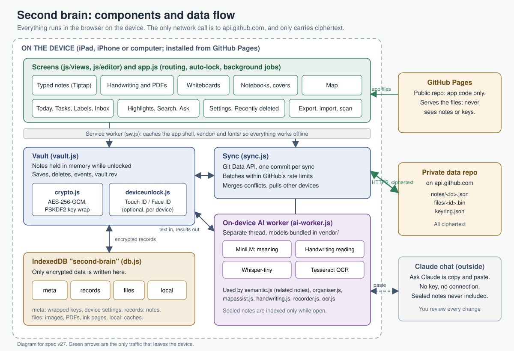
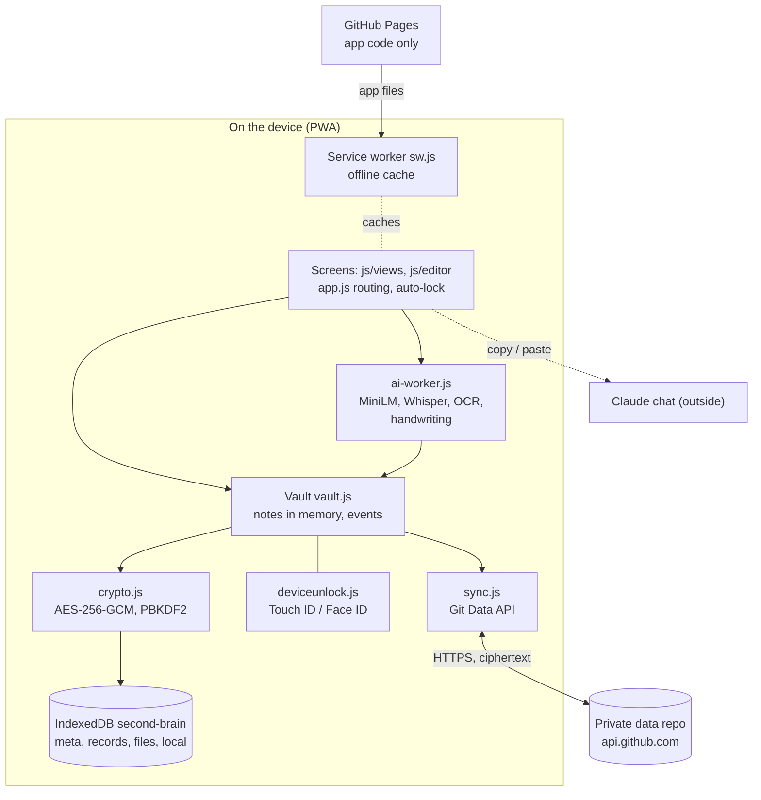
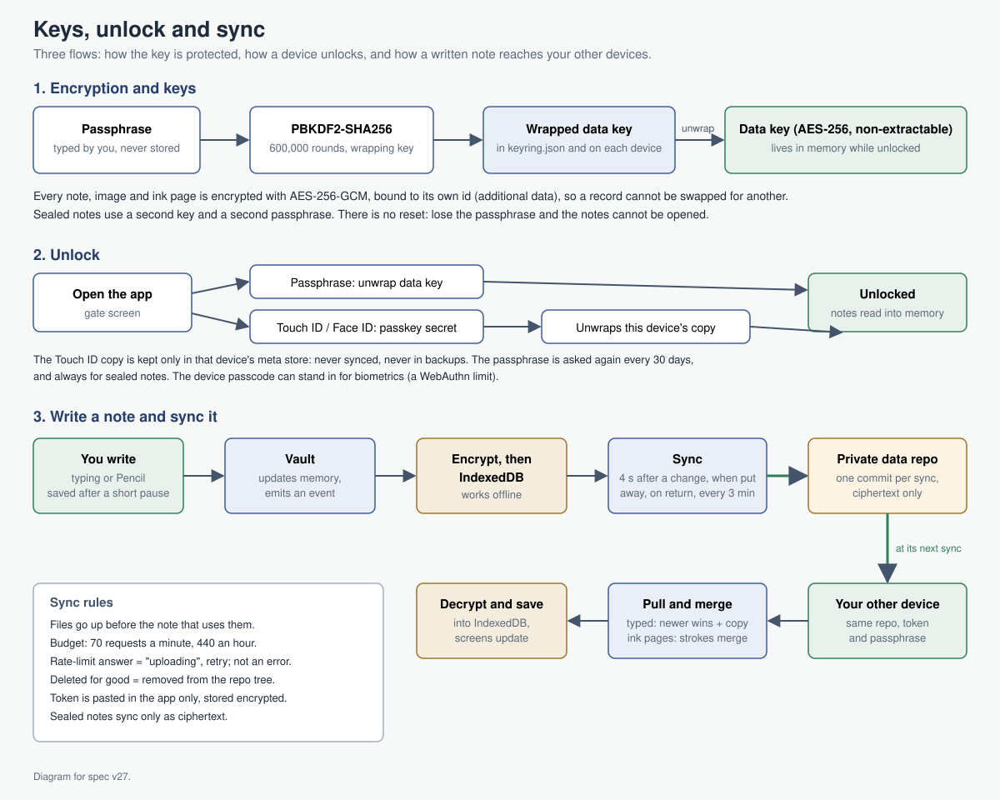
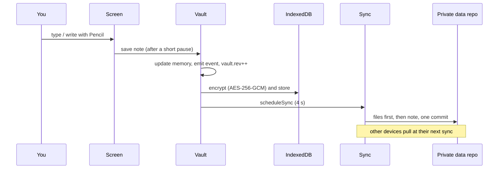
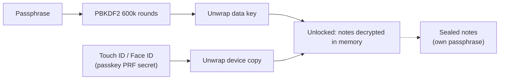
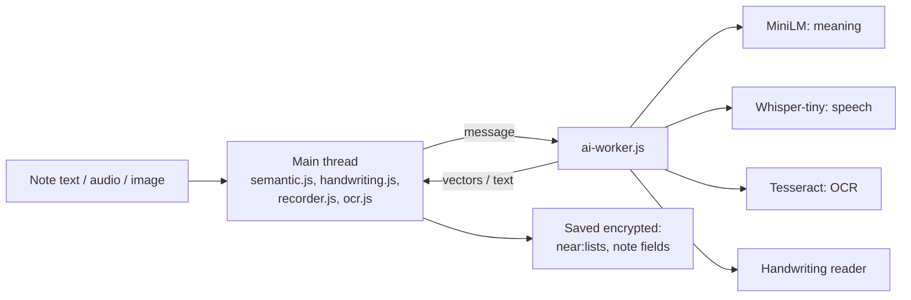

# Second brain: product specification

**Version 27** (app release `sb-v27`) · **12 November 2026**

## Version history

| Version | Date | What changed in this document |
|---|---|---|
| v27 | 12 Nov 2026 | First spec, written from `sb-v26`. In v27: typed notes no longer pushed right inside notebooks on wide iPads; per-note page view (Scroll down, Next page, Endless) for handwritten and PDF notes; Word and PowerPoint reader (import screens to follow); this spec. |

*(Later versions add a row here. See "How to update this document" at the end.)*

## Summary

Second brain is a private, encrypted notes app that the owner uses every day, mostly on an iPad with Apple Pencil, also on an iPhone and a computer. It holds typed notes, handwritten notes (Notability-style), PDFs to write on, whiteboards, and notebooks with covers. A map shows how notes connect (like Obsidian). Small AI models on the device file notes, find related ones, read handwriting, transcribe recordings and read text in pictures. Notes sync between devices through a private GitHub repo.

Three promises shape everything:

1. **Only the owner can read the notes.** Everything is encrypted on the device before it is stored or synced. Nothing goes to third parties.
2. **It works by itself.** The organiser files notes and the map assistant links them. The owner should need as little effort as possible.
3. **It works offline.** No server, no build step, no account other than GitHub for sync.

This document records the problems the app solves, what it must do (requirements), and how it is built. It is written for the owner (plain words) and for future developers and AI sessions (precise, with file names).

How to read it: section 1 is why, section 2 is what, section 3 is how, section 4 is the vocabulary. The *status* columns say whether something is done (and in which version) or planned.

Sources: `CLAUDE.md`, `README.md`, `docs/HANDOFF.md`, `docs/research/2026-11-06-feature-ideas.md`, `tests/README.md`, the git history and the code. Items marked "Planned" or "In progress" are not in the app yet.

---

## 1. Problem statements

### 1.1 Why the app exists

| ID | Problem (in the owner's terms) | Who it affects | Why it matters | Status |
|---|---|---|---|---|
| P-01 | "What I upload should only be available to myself." Ordinary notes apps keep notes on someone else's server. | The owner | Notes hold private plans, money, health and work. Security is the owner's first rule. | Solved (v1 on): encrypted on the device, ciphertext only in sync, no third parties |
| P-02 | Notes get lost across devices: a thought on the phone, a lecture on the iPad, a report on the computer. | The owner, all devices | One place everything lands means nothing is forgotten. | Solved: sync through a private GitHub repo |
| P-03 | Writing by hand with the Pencil is the main way of thinking, as in Notability. Typed-only apps do not fit. | The owner, iPad | Handwriting, PDFs to mark up and a good pen feel are daily needs. | Solved: handwritten notes, PDFs, zoom, pens |
| P-04 | Notes pile up and nobody files them. | The owner | Unfiled notes cannot be found again. | Solved: organiser files new notes; inbox with Undo |
| P-05 | It is hard to see how ideas connect. | The owner | Connections are where new ideas come from. | Solved: map, related notes, Noticed, themes |
| P-06 | Capturing must take seconds, on a phone. | The owner, iPhone | A slow capture is a lost capture. | Solved: Capture sheet; inbox |
| P-07 | Finding a note by the exact word fails when the note uses other words, or is handwriting, a picture or a recording. | The owner | Search that only matches typed words misses most of a day's material. | Solved: search by meaning; handwriting, OCR and transcripts are searchable |
| P-08 | Asking Claude about notes usually means giving a service access to everything. | The owner | The owner wants Claude's help without handing over notes or keys. | Solved: Ask Claude is copy and paste; sealed notes excluded |
| P-09 | A bought app can stop, change or vanish. The owner wants something that is theirs and does not need an engineer to run. | The owner | Long-term trust in the tool. | Solved: plain files on GitHub Pages, no server, no build |

### 1.2 Problems the owner raised over time

Dates and release numbers come from `CLAUDE.md` "Requests from the owner". The git history is short (the early history was squashed), so earlier items are listed by the feature they describe.

| ID | Problem (in the owner's terms) | Who it affects | Why it matters | Status |
|---|---|---|---|---|
| R-01 | Long notebook names get cut off on covers. | Owner, Notebooks | A name that is cut off cannot be read on the shelf. | Solved in v16: names break onto two lines (three if needed) |
| R-02 | Zoomed in on a handwritten note, I could not reach the far left or right of the page. | Owner, iPad | Cannot write or read at the page edges when zoomed. | Solved in v16 |
| R-03 | Imported PDFs looked soft when zoomed in. | Owner, iPad | Small print on lecture slides and forms must stay crisp. | Solved in v16: the original PDF is kept and drawn sharp |
| R-04 | I wanted more covers, and my own default text size and colour. | Owner | Making the app feel like theirs. | Solved in v17: 28 more covers (66 in 11 collections); default text in Settings |
| R-05 | Pinch-to-zoom did not follow my fingers and stopped at 3x. | Owner, iPad | Zoom is used all the time while writing. | Solved in v17: follows the fingers, up to 6x |
| R-06 | I deleted something by mistake (or want a safety net). | Owner | Losing a note for good is the worst outcome. | Solved in v19: Recently deleted, 30 days |
| R-07 | Old notes are forgotten. | Owner | Past notes should come back when they are useful. | Solved in v19: "From your notes" on Today |
| R-08 | I need to look at two notes at once (a PDF and my notes on it). | Owner, iPad and computer | Studying and writing from a source is a daily job. | Solved in v20: two notes side by side |
| R-09 | I need all my highlights in one place. | Owner | Highlighting is how the owner reads; collecting them by hand is slow. | Solved in v20: Highlights screen |
| R-10 | The note title and back button looked blurred on the iPad (not on a laptop). | Owner, iPad Home Screen app | A blurry title looks broken. | Solved in v22: an invisible bar on the top edge. Owner confirmed. |
| R-11 | Text boxes in handwritten notes did not land where I drew them. | Owner, iPad | Layout of handwritten pages must be predictable. | Solved in v23 |
| R-12 | Changing a typed note's title worked "sometimes". | Owner | Renaming should always work. | Solved in v23: tapping the title edits it |
| R-13 | Notebook lists were in the order notes were made; I want what I touched last at the top. | Owner | The note being worked on should be easy to reach. | Solved in v23 |
| R-14 | "Emptied Recently deleted on the iPad, still there on the computer." | Owner, two devices | Devices must agree, or deleted things come back. | Solved in v24: a waiting change is sent at once when the app is put away |
| R-15 | Moving a text box meant switching tools. | Owner, iPad | Every tool switch interrupts writing. | Solved in v25 |
| R-16 | Pasting a picture did not work well (Capture opened; nothing replaced). | Owner | Screenshots go into notes all day. | Solved in v25: Ctrl/Cmd+V and "Paste a picture" everywhere |
| R-17 | I cannot see how much work is waiting without opening each screen. | Owner | Due tasks should be visible at a glance. | Solved in v26: numbers in the menu |
| R-18 | Tasks across many regions are hard to scan; region colours too few to tell apart. | Owner | A busy task list needs structure. | Solved in v26: Tasks by region; 25 region colours |
| R-19 | Long typed notes are hard to move around in. | Owner | Long notes (study notes, reports) need a table of contents. | Solved in v26: Contents and Pages |

### 1.3 Problems being worked on now

| ID | Problem (in the owner's terms) | Who it affects | Why it matters | Status |
|---|---|---|---|---|
| N-01 | **Mark up a document.** I get Word (.docx) and PowerPoint (.pptx) files, PDFs and pictures, and want to open any of them and write on them, not only PDFs. | Owner, iPad | Work and study documents arrive in many formats. Converting each by hand before writing is a chore. | In progress (reader done in v27; import screens next). See the rules below. |
| N-02 | **Sections from imported documents.** Headings in Word, slide titles and sections in PowerPoint, and PDF bookmarks should appear in Contents by themselves. | Owner | A 60-slide deck is unusable without a way to jump around it. | In progress (reader done in v27; import screens next) |
| N-03 | **Pages in typed notes.** I want to add a page, choose per note whether it is Scroll down, Next page or Endless, and have text flow onto the next page by itself. | Owner | Typed notes should be able to behave like printed pages when that suits the work. | Planned |
| N-04 | **Next page or scroll, per note, for handwritten and PDF notes, and page options that are easy to find.** Today "Showing pages" is one setting for every note on the device and sits inside All pages. | Owner, iPad | Some notes (slides) suit turning pages, others (a long PDF) suit scrolling. The choice should be per note and visible. | Done v27 |
| N-05 | **A typed note is pushed to the right inside a notebook on a wide iPad.** | Owner, iPad | The note is cramped and looks broken in the owner's usual layout. | Done v27 |

**Rules for N-01 and N-02** (agreed so far):

- The work happens on the device only. Files are never sent to a conversion service.
- The result looks close to the original but not exact. Fonts, spacing and effects can differ.
- For an exact look, export to PDF first (from Word, PowerPoint or Pages) and open the PDF. PDFs are drawn from the original file, so they are exact.
- Pictures open as a page to write on.
- Sections found in the file appear in Contents without any work from the owner.

### 1.4 Out of scope

Reading Notability's own `.note` files (needs a binary parser and real samples); a redesign (slim menu rail, one-row toolbar, cover shelf: the owner said to ignore it); a hosted server of any kind.

### 1.5 Ideas waiting for a decision

From `docs/research/2026-11-06-feature-ideas.md`; items 1 to 4 are built. Not requested yet: your own paper (5), links to a page inside a handwritten note (6), voice capture into the inbox (7), reminders through Apple Calendar plus an app-icon count (8), pin favourites (9), saved searches (10), merge or split notes (11), flashcards (12), one note shown inside another (13), answers from a small local language model (14). Also: a reminder before the GitHub token expires, rows shown in batches in Inbox and Today, and confirming Touch ID / Face ID and Pencil-across-a-page-break on a real iPad.

---

## 2. Requirements

**How to read the tables.** *Shall* statements say what the app must do. *Status* is "Done vN" (the release that shipped it; "v1" means it predates the tracked history) or "Planned" / "In progress". *Test* names files in `tests/` (see `tests/README.md`). A dash means no automated test; those are manual checks. Where `tests/README.md` lists a range (for example t5g-t5l), the range is given because the list does not say which file covers which line.

### 2.1 Capture and inbox

| ID | Requirement | Status | Test |
|---|---|---|---|
| CA-01 | The app shall let the owner save a thought, screenshots or photos, and/or a link in seconds from a Capture sheet (the + button). | Done v1 | test1 |
| CA-02 | Captures shall land in the Inbox until filed. | Done v1 | test1 |
| CA-03 | From Capture the owner shall be able to scan paper, or start a typed note, a handwritten note or a whiteboard. | Done v1 | t5c |
| CA-04 | Photos and screenshots shall be shrunk before encryption, keeping screenshot text readable. | Done v1 | test1 |
| CA-05 | Pasting a picture (Ctrl/Cmd+V or "Paste a picture") shall go into the open note and never open Capture. | Done v25 | t6i |
| CA-06 | Dragging screenshots onto the map (iPad, computer) shall capture them. | Done v1 | - |
| CA-07 | Text in screenshots shall be read on the device (OCR) so it is searchable. | Done v1 | test1, t5c |
| CA-08 | Scanning shall find page edges, allow corner adjustment and offer colour, greyscale or black and white. | Done v1 | t5c |
| CA-09 | The organiser shall file new notes into regions when sure, with an undo list in the Inbox. | Done v1 | t5m |

### 2.2 Typed notes

| ID | Requirement | Status | Test |
|---|---|---|---|
| TN-01 | The app shall provide a rich editor with title, headings, lists, checklists, quote, callout, post-it, divider, tables, images, stickers, due dates and note links. | Done v1 | t4a, t5j, t5l |
| TN-02 | Typing `/` or markdown shortcuts (`#`, `-`, `1.`, `[ ]`, `>`, `!`, `---`) shall apply styles. | Done v1 | t5j (the `/` menu only) |
| TN-03 | The toolbar shall be the same two rows as handwritten notes and shall be present while reading, so nothing jumps. | Done v1 | t5k, t5l |
| TN-04 | The app shall offer seven fonts, sizes, alignment and 30 text colours, shown brightened in dark mode. | Done v1 | t6a |
| TN-05 | Tapping a note's title shall start editing the title, every time. | Done v23 | t6g |
| TN-06 | A default text font, size and colour (Settings) shall apply to typed notes (including existing ones), Today, PDF export, and start new text boxes and whiteboard text, which then keep their own values. | Done v17, extended v18 | t6a |
| TN-07 | `[[` shall link to another note; links shall show bold and blue. | Done v1 | t4a, t5n |
| TN-08 | Pictures shall be insertable by paste, drag and Insert menu, going where the cursor is (or the end while reading). | Done v25 | t5j, t6i |
| TN-09 | **Contents** shall list headings with reading time, mark the current one, jump under the sticky toolbar, and offer Back to top and To the end. | Done v26 | t6j |
| TN-10 | **Pages** shall show the note as printed pages and jump to the tapped page. | Done v26 | t6j |
| TN-11 | Contents shall also list sections found in imported Word/PowerPoint files and PDF bookmarks (see DI-05). | Planned | - |
| TN-12 | The owner shall be able to add a page to a typed note. | Planned | - |
| TN-13 | Each typed note shall have a page mode: Scroll down, Next page or Endless. | Planned | - |
| TN-14 | In Next page mode, text shall flow onto the next page by itself. | Planned | - |
| TN-15 | A typed note shall sit in the correct place (not pushed right) inside a notebook on a wide iPad. The Outline panel shows only outside notebooks. | Done v27 | t6k |
| TN-16 | A note shall have connections: links both ways, unlinked mentions, related notes by meaning, sub-notes. | Done v1 | t5n, t5p, t5w |
| TN-17 | Fields from a section's table view shall be folded below the text and shown on tap. | Done v1 | t5l |

### 2.3 Handwritten notes and PDFs

| ID | Requirement | Status | Test |
|---|---|---|---|
| HW-01 | The Pencil shall write; fingers shall scroll and pinch; the Pencil shall never be cancelled by a pinch. | Done v1 | t5z |
| HW-02 | The app shall offer pens (fountain, ballpoint, brush, pencil, marker, calligraphy) with colour, thickness, smoothing and pressure, plus favourites, highlighter, eraser, lasso, snapping shapes and text boxes. | Done v1 | t4b, t5i |
| HW-03 | Pages shall be A4, or an endless page that grows as the owner writes. | Done v1 | t5i |
| HW-04 | Paper shall be selectable: dot grid, lined, narrow lined, squared, Cornell, blank; in white, ivory or dark. | Done v1 | t5l |
| HW-05 | The owner shall be able to add, reorder and bookmark pages. | Done v1 | t4b |
| HW-06 | The continuous view (pages one under another) shall be the default; the one-at-a-time view shall be available. | Done v1 | t5r |
| HW-07 | A note shall reopen at the page last viewed. | Done v1 | t5q |
| HW-08 | The page view mode (Scroll down, Next page or Endless) shall be chosen per note and be easy to find on the note's own toolbar, for handwritten and PDF notes. Endless is not offered on PDF or photo pages. Adding a page shall work in both views. | Done v27 | t6l |
| HW-09 | Zoom shall run from 1x to 6x, follow the fingers (pinch) or the pointer (Ctrl/Cmd+wheel), show a label, and fit the page when the label is tapped. | Done v17 | t5z |
| HW-10 | Zoomed in, the owner shall be able to scroll and drag to every edge of the page, in both views. | Done v16 | t5x |
| HW-11 | Handwriting shall be read on the device a few seconds after writing stops, so it is searchable and usable in links and search by meaning. | Done v1 | t5h |
| HW-12 | Lasso + Convert to text shall show the reading for correction, then copy it or replace the ink with typed text. | Done v1 | t5h |
| HW-13 | A text box dragged out shall sit where drawn and wrap inside; a tapped box shall stay on screen when zoomed. | Done v23 | t6g |
| HW-14 | A text box or post-it shall move with the text tool (drag), or by its grip while typing, with undo. | Done v25 | t6i |
| HW-15 | The writing window (Zoom) shall let the owner write large and land small on the page. | Done v1 | t5g |
| HW-16 | Layers (Ink, Highlights, custom) shall be hideable and lockable; export shall include only visible layers. | Done v1 | t5g |
| HW-17 | A PDF shall open as a handwritten note whose pages can be drawn on; its text shall be searchable. | Done v1 | t5o |
| HW-18 | The original PDF (up to 40 MB) shall be kept, drawn sharp at any zoom, and embedded in exports with the writing on top. Bigger PDFs shall be kept as 2400 px page pictures. | Done v16 | t5y |
| HW-19 | Long PDFs (up to 300 pages) shall keep memory flat: only pages near the screen are drawn. | Done v1 | t5q |
| HW-20 | Many PDFs, or a zip of PDFs (Notability, GoodNotes exports), shall come in at once; zip folders become sections. | Done v1 | t5u |
| HW-21 | A laser pointer shall draw a fading line and save nothing. | Done v1 | t5o |
| HW-22 | Highlighted words shall be gathered on a Highlights screen: from the PDF's text, else handwriting, else OCR; a word counts when at least half is covered. | Done v20 | t6d |
| HW-23 | Pictures pasted shall land on the visible part of a handwritten page. | Done v25 | t6i |
| HW-24 | Recordings shall play back with writing that fades in by time, and tapping a word shall jump to that moment. | Done v1 | t5b |

### 2.4 Documents import (Mark up a document)

| ID | Requirement | Status | Test |
|---|---|---|---|
| DI-01 | The owner shall be able to open a Word (.docx) file and write on its pages. | In progress (reader done in v27; import screens next) | t6m |
| DI-02 | The owner shall be able to open a PowerPoint (.pptx) file and write on its slides. | In progress (reader done in v27; import screens next) | t6m |
| DI-03 | The owner shall be able to open a picture (photo, screenshot) as a page to write on. | Planned | - |
| DI-04 | All conversion shall run on the device. No file shall be sent to any service. | Planned | - |
| DI-05 | Headings (Word), slide titles and sections (PowerPoint) and PDF bookmarks shall appear in Contents without any action. | In progress (reader done in v27; import screens next) | t6m |
| DI-06 | The app shall tell the owner that imported Word and PowerPoint files look close to the original, not exact, and that an exact look comes from exporting to PDF first. | Planned | - |
| DI-07 | Opening a PDF shall keep working as in HW-17 to HW-20. | Done v1 | t5o, t5u, t5y |

### 2.5 Whiteboards

| ID | Requirement | Status | Test |
|---|---|---|---|
| WB-01 | A board shall hold cards for notes (existing or new), sticky notes, text, shapes, frames that carry their contents, photos, arrows that stay attached, and a pen. | Done v1 | t5e |
| WB-02 | The board shall pan and zoom (finger, trackpad, pinch) with an overview to jump around. | Done v1 | t5e, t5e_touch |
| WB-03 | Notes on a board shall show it among their connections. | Done v1 | t5e |
| WB-04 | A board shall export as PDF or image. | Done v1 | t5e |
| WB-05 | New board text shall start with the default text colour and nearest size. | Done v18 | t6a |
| WB-06 | Pasted pictures shall reach the board even when nothing is focused. | Done v25 | t6i |

### 2.6 Notebooks and covers

| ID | Requirement | Status | Test |
|---|---|---|---|
| NB-01 | A shelf of notebooks, each in a region, with sections, notes and sub-notes. | Done v1 | t4c, t5u |
| NB-02 | Covers shall come from a library of 66 in 11 collections, the owner's photo, or a plain colour. | Done v17 | t5s |
| NB-03 | Long names shall fit on the cover on two lines (three if needed); "…" only when nothing fits. | Done v16 | t5s |
| NB-04 | Notes and sub-notes shall list newest first by last change. | Done v23 | t6g |
| NB-05 | On a wide iPad the open note shall sit beside the notebook, and the side panel shall be hideable for more room (focus). | Done v1 | t5n |
| NB-06 | A section shall open as table, cards, timeline or board, with presets and filter, sort and group. | Done v1 | t5d |
| NB-07 | Two notes shall be openable side by side on wide screens (900 px or more), with a draggable divider, shared pens, swap, close and a remembered pair. | Done v20 | t6e |
| NB-08 | Side by side shall work for a note opened inside a notebook. | Done v21 | t6e |

### 2.7 Today, Tasks, Labels, Highlights

| ID | Requirement | Status | Test |
|---|---|---|---|
| TD-01 | Today shall show the week, what is due (late flagged), a quick "add a task", today's note and the day's captures; other days can be browsed. | Done v1 | smoke4, t5p |
| TD-02 | "From your notes" shall show notes from this day in earlier years and one older note worth another look; sealed notes never show. | Done v19 | t6c |
| TD-03 | "Your map this week" shall summarise new notes, regions, links and assistant actions, and be hideable. | Done v1 | t5p |
| TK-01 | Tasks shall gather checklists from every note, typed or handwritten, grouped by date, note or region; ticking updates the note. | Done v1, region v26 | t4a, t6j |
| TK-02 | The menu shall show "N due" on Today and Tasks, tasks left, a line per region, labels and highlights, kept up to date. | Done v26 | t6j |
| LB-01 | Labels stuck on pages shall be collected on a Labels screen with a preview of the spot; names and colours editable. | Done v1 | t4a, t5j |
| HL-01 | A Highlights screen shall list highlights with a picture, the words and a colour filter, with Copy as text and Remove; also per note and per notebook. | Done v20 | t6d |
| RG-01 | Regions shall have 25 colours, chosen from a grid that marks colours other regions use. | Done v26 | t6j |

### 2.8 Map and on-device AI

| ID | Requirement | Status | Test |
|---|---|---|---|
| MP-01 | The map shall show every note as a dot and every connection as a line in a kind-specific colour: links, sub-notes, boards, related by meaning. | Done v1 | t5n |
| MP-02 | The owner shall be able to show or hide kinds, light up a neighbourhood (one or two steps), see why two notes connect, and Link them or mark Not related. | Done v1 | t5n, t5p |
| MP-03 | The map shall offer a time filter, Replay and themes (dashed rings). | Done v1 | t5p |
| MP-04 | The map library shall load only when the map opens; the map shall rest when still. | Done v1 | t5q |
| MP-05 | The map assistant shall draw related lines, point out patterns under Noticed, and optionally auto-link very close notes, listing each in the Inbox with Undo. | Done v1 | t5p |
| MP-06 | The organiser shall classify by exemplar phrases and show a plan the owner can untick before filing; it shall add regions when needed. | Done v1 | t5m |
| AI-01 | Search by meaning (MiniLM) shall run on the device; lists of near notes shall be kept encrypted, sealed notes left out. | Done v1 | t5a, t5w |
| AI-02 | Handwriting reading, transcription (Whisper-tiny) and OCR (Tesseract) shall run on the device in a worker. | Done v1 | t5b, t5c, t5h |
| AI-03 | Model files shall be bundled in the app and cached for offline use. | Done v1 | - |
| AI-04 | "Ask Claude" shall build a prompt to paste into a Claude chat, import the reply, and show every change for review. Sealed notes shall be excluded. | Done v1 | test2, test3 |

### 2.9 Search

| ID | Requirement | Status | Test |
|---|---|---|---|
| SE-01 | All notes shall search titles, typed text, handwriting readings, PDF text, OCR and transcripts. | Done v1 | t5a, t5b, t5h |
| SE-02 | Results shall include notes "close in meaning". | Done v1 | t5w |
| SE-03 | Search shall stay quick at 10,000 notes (about 0.1 s). | Done v1 | perf/scale.py |

### 2.10 Sync and devices

| ID | Requirement | Status | Test |
|---|---|---|---|
| SY-01 | Notes shall sync to a private GitHub repo, one commit per sync, as ciphertext. | Done v1 | t4c |
| SY-02 | Sync shall run 4 s after a change, at once when the app is put away with a change waiting, on return, and every 3 minutes while visible. | Done v1, put-away v24 | t4c, t6h |
| SY-03 | Uploads shall go in batches within GitHub's limits (70 a minute, 440 an hour); a note's files before the note; rate-limit answers shall retry, not error. | Done v1 | t5v |
| SY-04 | Conflicts: typed notes keep the newer version and a "conflict copy" in the Inbox; ink pages merge strokes; notebooks merge. | Done v1 | test2, t4c |
| SY-05 | A second device shall join with the repo, token and passphrase. | Done v1 | test2 |
| SY-06 | Every sync commit shall double as version history; each note and ink page can be compared and restored. | Done v1 | t4c |
| SY-07 | Settings shall offer "Sync now" and show the sync state. | Done v1 | test2 |
| SY-08 | The app shall show an update bar when a new version is ready and a "Check for updates" button. | Done v1 | t5m |

### 2.11 Recently deleted

| ID | Requirement | Status | Test |
|---|---|---|---|
| RD-01 | Deleting a note, board or notebook shall put it in Recently deleted for 30 days, on all devices. | Done v19 | t6b |
| RD-02 | "Put back" shall restore it with pages, images and links; a notebook comes back with notes deleted with it. | Done v19 | t6b |
| RD-03 | "Delete now" and "Empty" shall remove for good, including files; after 30 days items go by themselves. | Done v19 | t6b |
| RD-04 | Emptying on one device shall reach the other at its next sync, and be sent at once when the app is put away. | Done v24 | t6h |
| RD-05 | Sealed binned notes shall leave the list when sealed notes lock. | Done v19 | - |

### 2.12 Export and backup

| ID | Requirement | Status | Test |
|---|---|---|---|
| EX-01 | A note or notebook shall export as PDF or Markdown; everything as a Markdown zip. | Done v1 | t5y |
| EX-02 | PDF export shall match the default text and embed original PDF pages with writing on top; turned pages become pictures. | Done v18 | t5y, t6a |
| EX-03 | Endless handwritten pages shall export as A4 pieces. | Done v1 | - |
| EX-04 | An encrypted backup shall be available in Settings. | Done v1 | - |
| EX-05 | Exports shall always use light paper. | Done v1 | - |

### 2.13 Settings

| ID | Requirement | Status | Test |
|---|---|---|---|
| ST-01 | Appearance: match device, light or dark; dark mode shall darken pages and boards, with an option to keep pages light. | Done v1 | t5l, t6a |
| ST-02 | Auto-lock after a chosen time. | Done v1 | - |
| ST-03 | Touch ID / Face ID unlock per device (see NF-S5). | Done v1 | t5t |
| ST-04 | Change passphrase; sealed notes with their own passphrase. | Done v1 | test2 |
| ST-05 | Regions, labels and stickers shall be editable and synced. | Done v1 | t6j |
| ST-06 | On-device intelligence: turn meaning search, organiser and auto-link on or off; rebuild the index. | Done v1 | t5m, t5w |
| ST-07 | "This device" shall show storage used, the app version and Check for updates; the app shall ask the browser to keep storage. | Done v1 | t5m |
| ST-08 | Default text (font, size, colour). | Done v17 | t6a |

### 2.14 Non-functional requirements

#### Security and privacy

| ID | Requirement | Test |
|---|---|---|
| NF-S1 | Everything stored or synced shall be AES-256-GCM encrypted (`js/crypto.js`). A random data key is wrapped by the passphrase (PBKDF2-SHA256, 600,000 rounds). The data key is created non-extractable. There is no reset. | test1, test2, t4c |
| NF-S2 | Each record shall be bound to its id (AES-GCM additional data). | - |
| NF-S3 | Sealed notes shall use a second key and passphrase, stay hidden until opened, never be indexed while locked, never be sent anywhere, and be excluded from Ask Claude. | test2 |
| NF-S4 | The Content-Security-Policy in `index.html` shall allow only `'self'` plus `https://api.github.com` for connections (scripts: `'self' 'wasm-unsafe-eval'`). Fonts, libraries and AI models are bundled in `vendor/` and `fonts/`. No third-party requests, analytics or CDNs. | - (checked by reading `index.html`) |
| NF-S5 | Touch ID / Face ID unlock shall be optional and per device. A WebAuthn passkey's PRF secret (HKDF, then AES-GCM) wraps a copy of the data key kept only in that device's `meta` store: never synced, never in backups. The passphrase is required every 30 days and always for sealed notes. The device passcode can stand in for biometrics (a WebAuthn limit). | t5t |
| NF-S6 | The GitHub token shall be pasted only into the app and stored encrypted. No one else (including Claude) shall ask for, read or handle it. | - |
| NF-S7 | "Ask Claude" shall need no API key; the owner copies and pastes. | - |
| NF-S8 | The repo shall hold only app code, never notes or personal data. | - |
| NF-S9 | Imported documents (N-01) shall be converted on the device. | - (planned) |

#### Performance (baselines at 10,000 notes, headless, no GPU)

| Action | Time |
|---|---|
| Unlock | about 1.2 s |
| All notes | 0.09 s |
| Search | about 0.1 s |
| Map opens | about 4 s, then idle |
| Save with the map open | about 0.06 s |
| Startup JS before unlock | about 510 KB |
| Long PDF flipping | memory stays flat (about 7 decoded pages kept) |

Measured by `tests/perf/` (`scale.py 10000`, `perf.py`, `startup.py`); these are measurements, not pass/fail tests. The meaning index is worked out once and then patched for changed notes only.

#### Offline

- The service worker (`sw.js`) caches the app shell, vendor files and fonts. Every new JS or CSS file shall be added to `SHELL`, or it will not work offline.
- `VERSION` (`sb-vN`) shall be bumped on every release so installed copies update.
- Saving is local first. Sync happens when a connection exists.
- AI model files are downloaded once (about 22 MB for meaning, 21 MB for handwriting, 44 MB for transcription) and kept.

#### Devices

- **iPad with Apple Pencil is the first-class target.** Layouts use the wide screen (side panel, side by side, notes beside notebooks).
- **iPhone** is for quick capture and reading. Notes open one at a time.
- **Computer** is supported with keyboard shortcuts, trackpad and wheel zoom.
- Runs as a Home Screen app (PWA). iOS Safari rules apply: WebAuthn needs a fresh tap; fingers scroll and the Pencil writes (`touch-action`); the iPadOS 26 top-edge blur is handled by `.edge-guard`.
- Touch ID / Face ID needs iPadOS or iOS 18 or later (or a browser with passkey PRF support).

#### Accessibility

- Tooltips on hover, and press-and-hold labels on touch devices for toolbar icons.
- Text colours meet at least 5.9:1 contrast in both themes (region colours).
- Light and dark themes; Atkinson Hyperlegible is among the bundled fonts.
- Large tap targets on touch screens. A fuller accessibility review (screen reader labels, reduced motion) has not been done and is not in the sources.

#### UI copy rules

- British / Singapore spelling (colour, organise), sentence case, plain everyday words, short hints.
- Buttons are verbs ("Bring in notes", "Unlock with Touch ID or Face ID").
- No technical terms in the UI (PRF, SHA, IndexedDB).
- No `alert`, `confirm` or `prompt`; use the shared sheets (`openSheet`, `popover`, `menuSheet`, `confirmSheet`, `passphraseSheet`).
- Explanations to the owner: plain words, outcome first, short.

#### Quality

- Every feature has a Playwright test; all tests pass before pushing. 80 tests, about 30 minutes (`cd tests && ./runall.sh`).
- Each source file opens with a plain-language comment.

### 2.15 Constraints and assumptions

**Constraints**

- No build step, no npm at runtime, no server. Plain HTML, CSS and JavaScript ES modules.
- No third-party requests. Everything the app needs is bundled.
- The app repo is public. Notes and personal details never go in it.
- GitHub limits: about 80 content requests a minute and 500 an hour; keep the data repo under about 1 GB; one file under 100 MB (so PDFs over 40 MB are kept as page pictures only).
- Safari gives the app up to about 60% of device storage.
- One imported PDF: up to 300 pages.
- Side by side needs a screen at least 900 px wide.
- Touch ID / Face ID depends on passkey PRF support.

**Assumptions**

- The owner has a GitHub account and creates a fine-grained token for the data repo, and renews it when it expires (sync shows a 401).
- The owner installs the app to the Home Screen so Safari does not clear its storage.
- The passphrase is remembered. Without it nothing can be opened.
- The owner reviews changes made by "Ask Claude" before accepting them.
- The owner is not a developer; releases are made with Claude Code.

---

## 3. Architecture

### 3.1 Overview

Second brain is a static web app: HTML, CSS and JavaScript files served from GitHub Pages. After the first load it runs entirely in the browser and works offline. There is no server of ours. The browser's IndexedDB holds encrypted notes. A private GitHub repo holds an encrypted copy so several devices stay in step. AI models run in a web worker on the device.

### 3.2 Data flows

**(a) Writing a note, saving, syncing**

1. The owner types or writes. The screen saves after a short pause (ink: debounced 600 ms per page).
2. `vault.js` updates the note in memory and emits an event (`note`, `page`, ...). `vault.rev` goes up, which other code uses as a cache key.
3. The note is encrypted (`crypto.js`, bound to its id) and written to IndexedDB. Ink pages and images are separate encrypted files.
4. `sync.js` runs 4 s later (`scheduleSync`), at once if the app is hidden with a change waiting, on becoming visible, and every 3 minutes while visible. It uploads files before the note, in batches, as one commit.
5. Another device pulls the commit at its next sync, decrypts, merges and saves. Screens update by event.

**(b) Unlock**

1. The gate screen (`views/gate.js`) asks for the passphrase.
2. PBKDF2-SHA256 (600,000 rounds) makes a wrapping key that unwraps the data key. The data key is non-extractable and lives only in memory.
3. With Touch ID / Face ID on, a passkey on this device returns a secret (WebAuthn PRF) that unwraps a device-only copy of the data key. This needs a fresh tap on iOS.
4. Notes are read from IndexedDB, decrypted into memory, and background jobs start (meaning index, purge of old deleted items, sync).
5. Sealed notes unlock separately, with their own passphrase and key.

**(c) On-device AI worker**

1. A screen or background job (`semantic.js`, `organiser.js`, `handwriting.js`, `recorder.js`, `ocr.js`) sends text, audio or an image to `ai-worker.js`.
2. The worker loads the model from `vendor/` (first use caches it) and returns vectors, text or labels. Nothing leaves the device.
3. Results are stored in the note or in `near:lists` (encrypted, sealed notes left out) and shown by the screens.

### 3.3 Data model in brief

- **Note** (`normNote` in `js/model.js`): `kind` is `note` (typed: `doc` / `body`), `ink` (handwritten: `pages[]`) or `board`. Also:
  - placement: `region`, `inbox`, `notebook`, `section`, `parent` (sub-notes);
  - connections and labels: `links`, `suggested`, `dismissed`, `labels`, `tasks`;
  - attachments: `files`, `recordings`, `props`, `pdfText`;
  - display: `layers`, `layout` (`scroll` = endless page);
  - flags: `sealed`, `daily`; deletion: `binnedAt`, `binBatch`.
- **Notebook**: `kind: notebook`, `sections[]`, `cover { style, color, photo, titleStyle }`, `paper`, `paperColor`.
- **Handwritten page**: `{ id, paper, color, h, bg?, pdf? }`. The page's ink is a separate encrypted file (gzip JSON of strokes and objects). `bg` is a background image file id. `pdf: { file, n }` points at the kept original PDF (one file per import) and the page number. A page is 1000 units wide.
- **Device settings** (`state.device`, encrypted, not synced): paper, page view, semantic, organise, autoLink, autoLockMin, sync target and token, organiser log and more.
- **Synced settings** (`state.config`): regions, labels, stickers, default text.
- **Sync repo layout**: `notes/<id>.json`, `files/<id>.bin`, `keyring.json`.
- **IndexedDB stores**: `meta`, `records`, `files`, `local`.

### 3.4 Module map

| Area | Files |
|---|---|
| Entry, routing, auto-lock, background jobs | `js/app.js` |
| Vault, storage, events | `js/vault.js`, `js/db.js` |
| Encryption, device unlock | `js/crypto.js`, `js/deviceunlock.js` |
| Sync | `js/sync.js` |
| Note model, search, tasks, daily notes | `js/model.js`, `js/doc.js`, `js/notework.js`, `js/connections.js` |
| Typed notes | `js/views/note.js`, `js/editor/rich.js`, `js/editor/toolbar.js`, `js/fonts.js`, `js/views/contents.js` |
| Handwritten notes | `js/views/inknote.js`, `js/editor/ink.js`, `js/editor/inkdraw.js`, `js/editor/pagestack.js`, `js/editor/zoomstrip.js`, `js/handwriting.js` |
| Highlights | `js/highlights.js`, `js/views/highlights.js` |
| Side by side, focus | `js/views/split.js`, `js/focus.js` |
| PDFs and import | `js/pdf.js`, `js/pdfview.js`, `js/bulkimport.js`, `js/views/importsheet.js`, `js/handoff.js` |
| Export | `js/export.js`, `js/markdown.js` |
| Whiteboards | `js/views/board.js`, `js/boarddraw.js` |
| Notebooks, covers | `js/views/notebooks.js`, `js/covers.js`, `js/coverart.js`, `js/coverart2.js` (generated by `tools/covergen.py` and `tools/covergen2.py`) |
| Map | `js/views/map.js`, `js/graph.js`, `js/mapdata.js`, `js/mapassist.js`, `js/minimap.js` |
| On-device AI | `js/ai.js`, `js/ai-worker.js`, `js/semantic.js`, `js/organiser.js`, `js/ocr.js`, `js/recorder.js`, `js/scan.js` |
| Ask Claude | `js/claude.js`, `js/views/ask.js`, `js/views/review.js` |
| Screens | `today.js`, `inbox.js`, `notes.js`, `tasks.js`, `labels.js`, `tableview.js`, `history.js`, `scanner.js`, `settings.js`, `gate.js`, `shell.js`, `deleted.js`, `capture.js`, `organise.js`, `recordings.js` (all in `js/views/`) |
| Today extras | `js/resurface.js`, `js/counts.js` |
| Pictures, clipboard | `js/images.js`, `js/clipimages.js` |
| UI helpers, theme, icons | `js/ui.js`, `js/util.js`, `js/theme.js`, `js/icons.js`, `js/stickers.js` |
| Updates, offline | `sw.js`, `js/appupdate.js` |
| Shell and security policy | `index.html`, `css/app.css`, `css/notes.css`, `manifest.webmanifest` |
| Libraries and models | `vendor/`, `fonts/` |
| Tests, tools | `tests/`, `tools/` |

Routes (hash-based, in `js/app.js`): `#/today`, `#/map`, `#/inbox`, `#/notes`, `#/note/:id`, `#/notebooks`, `#/notebook/:id`, `#/tasks`, `#/labels`, `#/ask`, `#/review`, `#/settings`, `#/deleted`, `#/highlights`, and `#/note/:id?beside=:id2`. Each view exports `mount(main, params, ctx)` returning `{ update, onEvent, destroy }`.

Events (`vault.emit`): `note`, `delete`, `remote`, `sealed`, `config`, `sync`, `unlock`, `device`, `notebook`, `page`, `ocr`.

### 3.5 Key design decisions

| Decision | Why | Consequence |
|---|---|---|
| **No build step, no npm at runtime** | The owner is not a developer; edit-and-push must be enough. | Libraries are vendored in `vendor/`. Plain ES modules. |
| **No server of ours** | Nothing to run, pay for or breach. | Everything runs in the browser; GitHub Pages only serves files. |
| **Everything encrypted on the device** | "What I upload should only be available to myself." | No reset; passphrase loss is final. The data key is non-extractable. |
| **GitHub as storage and sync** | The owner already has an account; commits give version history for free. | Rate limits shape the sync (batches, budgets). Token must be renewed. |
| **AI on the device, in a worker** | Notes never leave the device. | Models are bundled and downloaded once; heavy work is time-sliced. |
| **"Ask Claude" is copy and paste** | Claude helps without access or a key. | The owner pastes and reviews each change. Sealed notes never included. |
| **Static CSP with only `'self'` and `api.github.com`** | Blocks accidental or hostile third-party requests. | No CDNs or analytics, ever. |
| **Binned notes stay in the record set with `binnedAt`** | So deletion syncs and can be undone. | `place()` hides them from every other screen. Older app versions would show them, so devices must update. |
| **Ink pages as separate encrypted files** | A stroke should not rewrite the whole note. | Files go up before the note; pages merge stroke by stroke. |
| **Only visible parts of a page get pixels; PDFs drawn from the original** | Keeps long PDFs fast and sharp. | Careful layout rules (see `CLAUDE.md` "Things that are easy to break"). |
| **Mockup first for big features; every feature gets a test** | The owner likes to see it before it is built. | Releases take time, but regressions are rare. |

---

## 4. Glossary

| Term | Meaning |
|---|---|
| **Region** | A top-level area of life or work (for example Health, Work). Notes are filed into regions; the map clusters notes by region. Synced; 25 colours. |
| **Notebook** | A shelf item with a cover that holds sections, notes and sub-notes. Lives in a region. |
| **Section** | A group of notes inside a notebook. Can be shown as table, cards, timeline or board. |
| **Sub-note** | A note placed under another note. |
| **Typed note** | A note written with the keyboard (`kind: note`). |
| **Handwritten note** | A note of pages to write on with the Pencil (`kind: ink`). Also how a PDF opens. |
| **Whiteboard** | An open canvas of cards, sticky notes, shapes and arrows (`kind: board`). |
| **Page** | One sheet of a handwritten note: paper, optional background (photo or PDF page) and ink. |
| **Endless page** | A handwritten note's layout as one long page that grows (`layout: scroll`). |
| **Continuous view / One at a time** | Two ways to move through pages: scroll them one under another, or turn them. |
| **Layer** | A level of a handwritten page: Ink, Highlights, or your own. Can be hidden or locked. |
| **Highlight** | A highlighter stroke (or typed highlight mark) gathered with its words on the Highlights screen. |
| **Label** | A tag stuck anywhere on a page (for example Important) to find the spot later. |
| **Sticker / post-it** | Decoration. Post-its fold to a small square. Not for finding things (use labels). |
| **Inbox** | Where captures wait to be filed. |
| **Capture** | The quick-save sheet (the + button). |
| **Today** | Home screen: the week, what is due, today's note, the day's captures. |
| **Daily note** | The note for one day, typed into straight from Today. |
| **Organiser** | On-device filing of notes into regions, with a plan to review and Undo. |
| **Map assistant** | On-device helper that draws related lines, points out patterns (Noticed) and can auto-link. |
| **Connections** | Links both ways, unlinked mentions, related notes and sub-notes for a note. |
| **Related (by meaning)** | Notes the device judges to say similar things; amber dashed lines on the map. |
| **Theme** | A dashed ring on the map around notes in a region that belong together. |
| **Sealed note** | A note behind a second passphrase, hidden until opened, never shared. |
| **Passphrase** | The words that unlock the data key. Cannot be reset. |
| **Data key** | The random key that encrypts everything. Wrapped by the passphrase. |
| **Vault** | The unlocked, in-memory copy of the notes (`vault.js`). |
| **Recently deleted** | The 30-day bin for notes, boards and notebooks. |
| **Conflict copy** | The older version kept in the Inbox when two devices edited the same typed note. |
| **Data repo** | The private GitHub repo (`second-brain-data`) holding ciphertext. |
| **Ask Claude** | Copy-and-paste prompts for a Claude chat; the reply is imported and reviewed. |
| **Contents / Pages** | Typed-note navigation: headings with reading times, and a printed-page view. |
| **Focus** | Hiding the side panel and notebook list for more room to write. |
| **Beside / side by side** | Two notes open next to each other on wide screens. |
| **Service worker** | The browser helper that stores the app for offline use and fetches updates. |
| **PWA** | A web app installed to the Home Screen. |
| **Mark up a document** | Opening a file to write on it (PDF today; Word, PowerPoint and pictures planned). |

---

## 5. How to update this document

1. Copy this file to `docs/spec/Second Brain - Spec vN.md`, where N is the new service-worker version (for example `v28`). Leave older versions alone: they are the record.
2. Add a row to the Version history table (version, date, what changed). Change the version and date at the top.
3. Update statuses: move "Planned" and "In progress" items to "Done vN" when they ship, and add new problems and requirements. Add a new test name to each requirement. Keep requirement IDs stable; never reuse one.
4. Keep the architecture section true. If the components or flows change, copy the SVGs to `architecture-vN.svg` and `sync-vN.svg`, edit them, and point the image links at the new files. Update the Mermaid blocks too.
5. Check the facts against the code: `sw.js` `VERSION`, `tests/README.md`, the baselines in `CLAUDE.md`, the CSP in `index.html`.
6. Regenerate the PDF: `python3 docs/spec/build_pdf.py "docs/spec/Second Brain - Spec vN.md"`.
7. Commit only `docs/spec/`. Never put notes, tokens, email addresses or personal details in this file: the repo is public.
